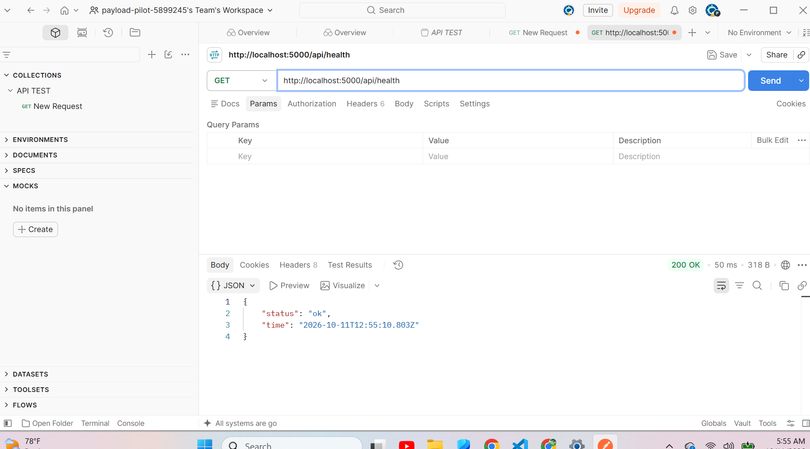
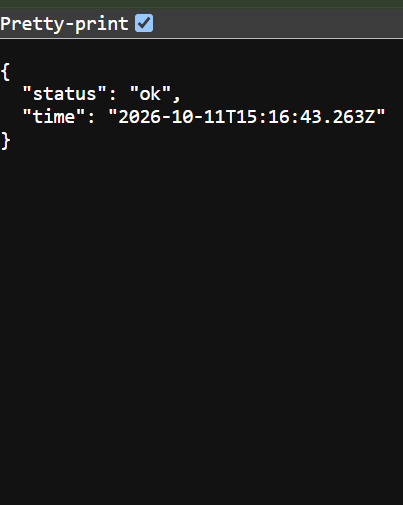
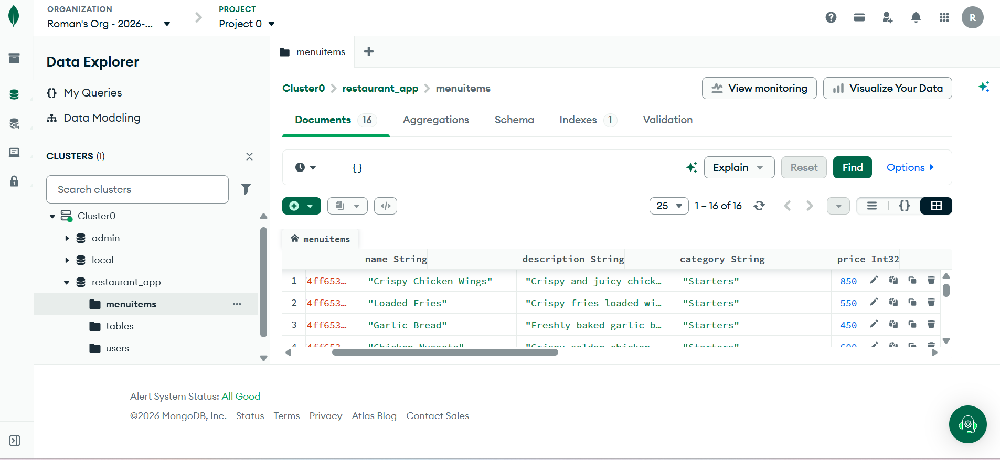
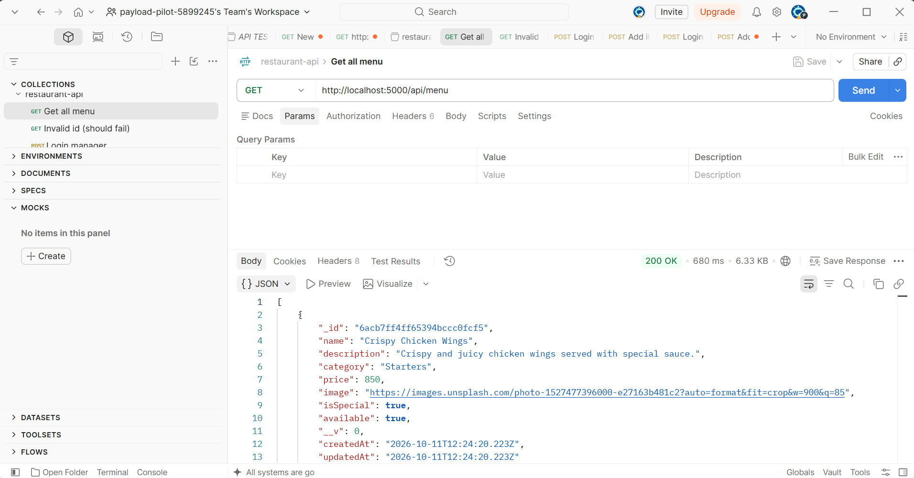
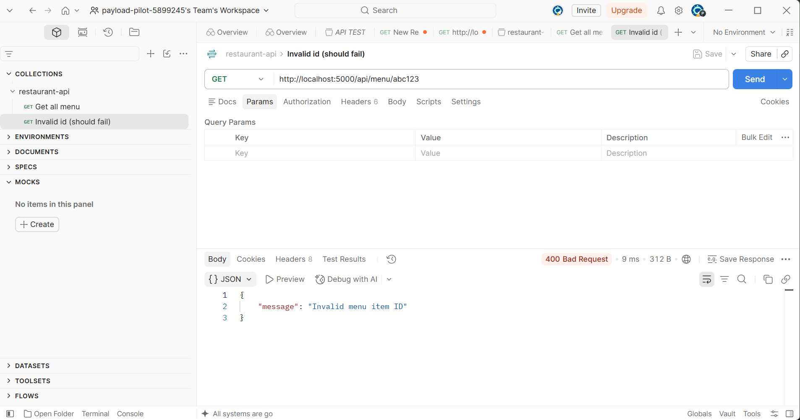
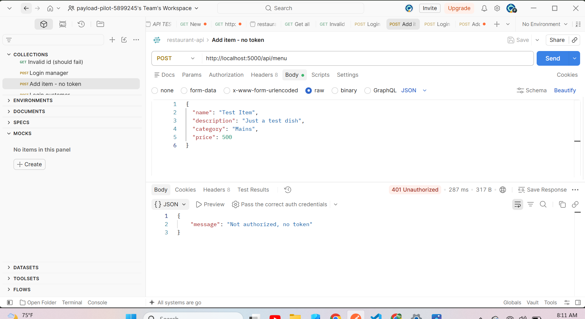
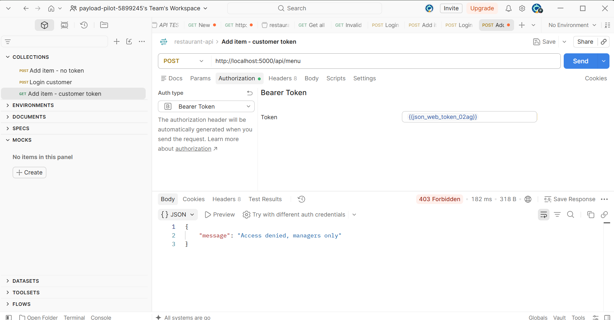
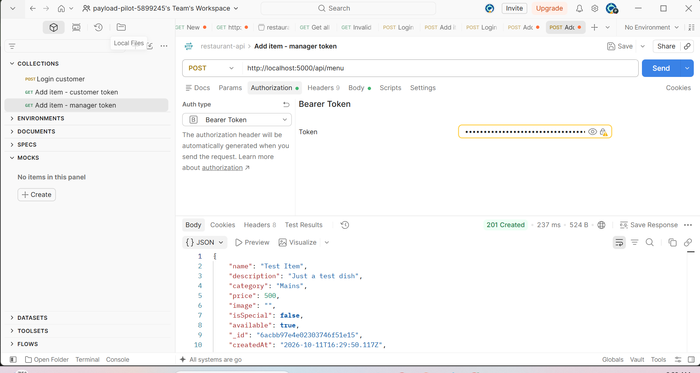
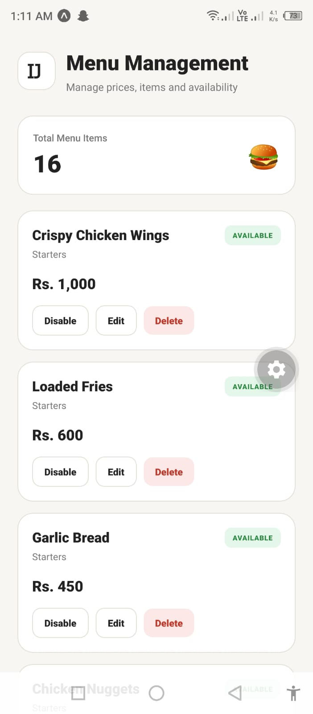
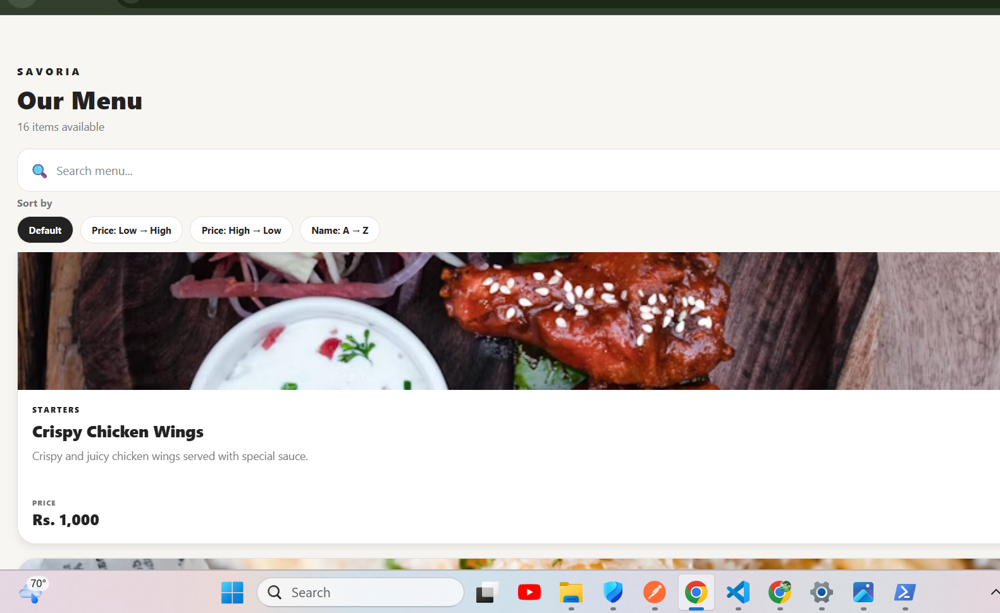

## Assignment 2 — Backend and Database (Fall 2026)

Assignment 2 extends the Assignment 1 app with a **Node.js / Express API server** and a **MongoDB Atlas** database. The app now loads and saves data through the server, so a manager's change appears on every customer's device.

```text
React Native / Expo App  →  Express API Server  →  MongoDB Atlas
```

Documents and test evidence are in the [`A2/`](A2/) folder:

- [`A2/SRS_v2.pdf`](A2/SRS_v2.pdf): updated SRS (database design, API design, diagrams)
- [`A2/restaurant-api.postman_collection.json`](A2/restaurant-api.postman_collection.json): Postman collection
- [`A2/screenshots/`](A2/screenshots/): test screenshots

### Demo video

[Watch the two-device demo (under 4 minutes)](PASTE_VIDEO_LINK_HERE)

---

### Run the server

Requirements: Node.js, npm, and a free MongoDB Atlas cluster.

1. Install the server packages:

```bash
cd server
npm install
```

2. Create the `.env` file from the example (Windows PowerShell: `copy .env.example .env`):

```bash
cp .env.example .env
```

3. Open `server/.env` and fill in the values:

```text
PORT=5000
MONGO_URI=<your MongoDB Atlas connection string, database name restaurant_app>
JWT_SECRET=<any long random text>
```

`.env` is ignored by Git. Never commit real passwords or secrets. In Atlas, add your current IP under **Network Access**.

4. Add the starting data (2 users, 16 menu items, 6 tables). This clears the old data first:

```bash
npm run seed
```

5. Start the server:

```bash
npm run dev
```

You should see `MongoDB connected` and `Server running on port 5000`. Check it at `http://localhost:5000/api/health`.

### Run the app

From the project root:

```bash
npm install
npx expo start
```

Open the app in Expo Go. The phone and the laptop must be on the same Wi-Fi.

### Where to change BASE_URL

Open `src/api/client.js` and change this one line to your laptop's IPv4 address (run `ipconfig` and read the Wi-Fi IPv4 Address):

```js
export const BASE_URL = "http://192.168.1.5:5000";
```

The laptop IP can change when the router restarts, so check it again if the app cannot reach the server. On a Windows laptop, allow ports 5000 and 8081 in the firewall.

### Seeded login details

| Role | Email | Password |
|---|---|---|
| Manager | manager@restaurant.com | manager123 |
| Customer | ali@example.com | customer123 |

New signups are always created as **customers**. Passwords are stored hashed (bcrypt). These are demo accounts created by `npm run seed`.

---

### API endpoints

Base URL: `http://<laptop-ip>:5000`. Protected routes need the header `Authorization: Bearer <token>`. The token comes from the login endpoint and expires in one day.

| Method | Endpoint | Access | Description |
|---|---|---|---|
| GET | `/api/health` | Public | Server health check |
| POST | `/api/auth/register` | Public | Create a customer account (409 if the email exists) |
| POST | `/api/auth/login` | Public | Log in and get a token, name, email and role |
| GET | `/api/menu` | Public | List menu items (optional `category` and `search` query) |
| GET | `/api/menu/:id` | Public | Get one menu item |
| POST | `/api/menu` | Manager | Add a menu item |
| PUT | `/api/menu/:id` | Manager | Edit a menu item |
| DELETE | `/api/menu/:id` | Manager | Delete a menu item |
| POST | `/api/orders` | Logged in | Place an order (total is calculated by the server) |
| GET | `/api/orders/my` | Logged in | The customer's own orders |
| GET | `/api/orders` | Manager | All orders |
| PATCH | `/api/orders/:id/status` | Logged in | Change order status (customers may only cancel their own Pending order) |
| GET | `/api/tables` | Logged in | List tables with availability |
| POST | `/api/reservations` | Logged in | Reserve a table (400 if too many guests, 409 if already booked) |
| GET | `/api/reservations/my` | Logged in | The customer's own reservations |
| GET | `/api/reservations` | Manager | All reservations |
| PATCH | `/api/reservations/:id` | Manager | Accept or decline a reservation |

**Business rules**

- Order status moves only forward: `Pending → Preparing → Ready → Served`. An order can be cancelled only while it is `Pending`. Any other change returns 400.
- The server rejects unavailable menu items and never trusts a total sent by the app.
- Invalid IDs return 400, missing items return 404, no token returns 401, and the wrong role returns 403.

---

### Screenshots

| Question | Screenshot |
|---|---|
| Q2: health route in Postman |  |
| Q2: health route on the phone |  |
| Q3: `menuitems` collection in Atlas |  |
| Q4: request that works (200) |  |
| Q4: request that fails (400) |  |
| Q5: no token (401) |  |
| Q5: customer token (403) |  |
| Q5: manager token (201) |  |
| Q6: manager changes a price on the phone |  |
| Q6: customer sees the new price |  |

---
# Savoria Restaurant App MVP

Restaurant App MVP developed for **Assignment No. 1 and Assignment No. 2 — Fall 2026**.

Savoria is a **React Native restaurant application** built with Expo and Expo Router. Assignment 1 built the frontend with local mock data. Assignment 2 (the section above) connects it to an Express API server and a MongoDB database.

---

## 1. Project Scope

Savoria provides the following main functionality.

### Customer

- Local mock authentication
- Login and signup
- Email and password validation
- Role selection during signup
- Loading feedback during authentication
- Menu browsing
- Daily Specials
- Category filtering
- Search
- Debounced search
- Sorting
- Favourites
- Menu availability indicators
- Pull-to-refresh
- Back-to-Top control
- Cart management
- Quantity increment/decrement
- Remove and clear cart
- Special instructions for cart items
- Promo codes
- Live order totals
- Dine-in ordering
- Takeaway ordering
- Table selection for Dine-in
- Pickup time for Takeaway
- Order confirmation
- Order tracking
- Table reservations
- Reservation cancellation
- Profile
- Light/Dark theme switching
- Logout

### Restaurant Manager

- Role-based Manager Dashboard
- Incoming Orders
- Manual order-status updates
- Reservations management
- Accept/decline reservations
- Menu Management
- Add menu items
- Edit menu prices
- Toggle menu availability

---

## 2. Technology Stack

### App

- React Native, Expo, Expo Router
- TypeScript / JavaScript
- React Hooks, Context API, useReducer, custom hooks
- AsyncStorage (keeps the login session)

### Backend (Assignment 2)

- Node.js and Express
- MongoDB Atlas with Mongoose
- JSON Web Tokens (jsonwebtoken) and bcryptjs for authentication
- dotenv, cors, nodemon

Real payments and push notifications are still out of scope.

---
## 3. Project Structure

```text
restaurant-app-mvp/
│
├── A1/
│   ├── SRS.pdf
│   ├── SRS.md
│   └── UML/
│       ├── Class_Diagram.png
│       ├── Component_Diagram.png
│       ├── Sequence_Diagram.png
│       ├── State_Machine_Diagram.png
│       └── Use_Case_Diagram.png
│
├── src/
│   ├── app/
│   ├── components/
│   ├── context/
│   ├── data/
│   ├── hooks/
│   └── reducers/
│
├── package.json
├── app.json
└── README.md
```

The application uses **Expo Router** for routes and screens.

---

## 4. Installation

### Requirements

Install the following before running the project:

- Node.js
- npm
- Git
- Expo-compatible environment
- Expo Go for physical-device testing

### Clone Repository

```bash
git clone https://github.com/Romee-1018/restaurant-app-mvp.git
cd restaurant-app-mvp
```

### Install Dependencies

```bash
npm install
```

---

## 5. Running the Application

Start the Expo development server:

```bash
npx expo start
```

### Expo Go

1. Install Expo Go on the mobile device.
2. Connect the computer and mobile device to the same network.
3. Run:

```bash
npx expo start
```

4. Scan the QR code using Expo Go.

### Web

The application can also be opened using the web option provided by the Expo development server.

---

## 6. Authentication

Login and signup use the Express server (`POST /api/auth/login` and `POST /api/auth/register`). The server returns a token, which the app keeps in AuthContext and AsyncStorage. Logging out clears both.

The seeded demo accounts are listed in the Assignment 2 section at the top of this file. The old mock users file (`src/data/users.js`) was removed in Assignment 2.

---

## 7. React Hooks Used

The application demonstrates the following React hooks.

| Hook | Purpose |
|---|---|
| useState | Form values, UI state, filters, search, reservation values and order-type choices |
| useEffect | Data loading, timers, AsyncStorage operations and cleanup |
| useRef | TextInput, FlatList, timers, scroll handling and render counter |
| useContext | Authentication, theme, cart, menu and orders shared state |
| useReducer | Cart and order state transitions |
| useMemo | Menu filtering, sorting and derived totals |
| useCallback | Stable event handlers |
| React.memo | Avoid unnecessary MenuItemCard re-renders |
| Custom Hooks | Reusable form, debounce and reservation logic |

---

## 8. Hook-to-Screen Mapping

| Screen / Feature | Hooks / Logic |
|---|---|
| Login / Signup | useState, useAuth/useContext, useForm |
| Menu / Explore | useState, useEffect, useMemo, useCallback, useRef, useDebounce, useTheme, useCart |
| Search | useState, useRef, useDebounce |
| Profile / Theme | useAuth, useTheme, useContext |
| Cart | useReducer through CartContext, useMemo, useTheme |
| Order Summary | useMemo, useState, useCallback |
| Table Reservation | useReservation, useForm, useMemo, useState |
| Order Tracking | useEffect, timers, AsyncStorage, shared order state |
| Manager Dashboard | useContext, useEffect, useReducer, useMemo, useCallback |

---

## 9. Main Application Screens

### Customer Screens

- Login / Signup
- Menu / Explore
- Search
- Profile
- Cart
- Order Summary
- Reservations
- Order Confirmation
- Order Tracking

### Manager Screens

- Manager Dashboard
- Incoming Orders
- Reservations Management
- Menu Management

---

## 10. State Management

### AuthContext

Responsible for:

- Current authenticated user
- Login
- Signup
- Logout
- Role-based visibility

### ThemeContext

Responsible for:

- Light theme
- Dark theme
- Theme switching
- Consistent screen colours

### CartContext

Responsible for:

- Cart items
- Quantities
- Special instructions
- Promo codes
- Discounts
- Cart state

### MenuContext

Responsible for:

- Shared menu data
- Menu changes
- Menu availability
- Menu price updates

### OrdersContext

Responsible for:

- Creating orders
- Order state
- Order status updates
- Order persistence

---

## 11. Reducers

Reducers are used for complex state transitions.

### Cart Reducer

Location:

```text
src/reducers/cartReducer.js
```

Supported actions include:

- ADD_ITEM
- REMOVE_ITEM
- INCREMENT
- DECREMENT
- UPDATE_NOTE
- CLEAR_CART
- APPLY_PROMO
- REMOVE_PROMO

Reducers calculate new state without mutating the previous state.

---

## 12. Custom Hooks

Reusable custom hooks are stored in:

```text
src/hooks/
```

### useForm

Handles:

- Form values
- Validation
- Errors
- Form submission
- Reset

### useDebounce

Applies search/filter changes after the required inactivity period.

The menu search requirement uses a **400 millisecond debounce**.

### useReservation

Handles:

- Reservation date
- Time slot
- Party size
- Table availability
- Contact details
- Reservation creation
- Reservation cancellation

---

## 13. Menu Features

The Menu / Explore screen supports:

- At least four categories:
  - Starters
  - Mains
  - Desserts
  - Drinks
- Daily Special badges
- Availability indicators
- Add to Cart
- Search
- Debounced search
- Last five search suggestions
- Category filtering
- Sorting
- Favourites
- Pull-to-refresh
- Loading state
- Retryable error state
- Empty search state
- Back-to-Top control
- FlatList for menu rendering

Menu data is stored locally.

---

## 14. Search and Scroll Controls

The search functionality provides:

- Search input
- Search focus control
- Search filtering
- 400ms debounce
- Last five search terms
- Search suggestions
- Clear search
- Friendly empty state

The Back-to-Top control becomes available after the menu list has been scrolled more than **300 pixels**.

`useRef` is used for relevant TextInput, FlatList, timers, and render-counter functionality.

---

## 15. Cart and Checkout

Customers can:

1. Add available menu items.
2. Increase item quantity.
3. Decrease item quantity.
4. Remove items.
5. Clear the cart.
6. Add special instructions.
7. Apply a valid promo code.
8. Receive an error for an invalid promo code.
9. View live item count.
10. View calculated totals.
11. Continue to Order Summary.

### Order Summary

The Order Summary includes:

- Items
- Subtotal
- 5% service charge
- 15% sales tax
- Promo discount
- Grand total
- Order type

Customers can choose:

- Dine-in
- Takeaway

Dine-in requires a table, while Takeaway requires a pickup time.

---

## 16. Table Reservations

Customers can:

- Select a reservation date
- Select party size
- Select an hourly time slot
- Select an available table
- Enter contact details
- Review a confirmation summary
- Save a reservation
- View existing reservations
- Cancel a reservation

### Reservation Rules

- Hourly slots are available from 12:00 through 22:00.
- Time slots are disabled when no suitable table is available.
- Party size must be between 1 and 12.
- Past dates are rejected.
- The reservation must be at least one hour ahead of the current time.
- Phone numbers must follow the required `03XX-XXXXXXX` format.

---

## 17. Order Tracking

Orders follow the demo lifecycle:

```text
Pending
   ↓
Preparing
   ↓
Ready
   ↓
Served
```

Orders may also be cancelled according to the supported workflow.

### Demo Timing

In demo mode:

- Pending → Preparing after 10 seconds
- Preparing → Ready after 20 seconds
- Ready → Served after 30 seconds

The Order Tracking screen displays:

- Order ID
- Current status
- Step indicator
- Order items
- Total
- Elapsed-time counter

The elapsed-time counter updates every second.

Order-related intervals are cleaned up when the tracking screen unmounts.

---

## 18. Manager Dashboard

The Manager Dashboard is visible only when the authenticated user's role is `manager`.

The dashboard provides three main tabs.

### Incoming Orders

Managers can:

- View incoming orders
- Manually update order status

### Reservations

Managers can:

- View reservations
- Accept reservations
- Decline reservations

### Menu Management

Managers can:

- Add menu items
- Edit menu prices
- Toggle menu availability

Manager menu changes are reflected in the customer menu through shared state.

---

## 19. AsyncStorage

AsyncStorage provides local persistence for supported application data.

The application uses local persistence for:

- Orders
- Reservations
- Menu edits

The application also provides loading states while persisted information is being loaded.

No cloud database is required.

---

## 20. UML Diagrams

The UML diagrams for Assignment No. 1 are stored in:

```text
A1/UML/
```

### Use Case Diagram

Shows the:

- Customer actor
- Restaurant Manager actor
- Major application use cases
- Relevant use-case relationships

File:

```text
A1/UML/Use_Case_Diagram.png
```

### Class Diagram

Models:

- User
- Customer
- Manager
- Category
- MenuItem
- Cart
- CartItem
- Order
- Reservation
- Table

The diagram includes attributes, operations, inheritance, relationships, and multiplicities.

File:

```text
A1/UML/Class_Diagram.png
```

### Sequence Diagram

Models the customer placing an order from adding an item to the cart through order creation and reaching Order Tracking.

File:

```text
A1/UML/Sequence_Diagram.png
```

### State Machine Diagram

Models the Order lifecycle:

```text
Pending → Preparing → Ready → Served
```

and the supported Cancelled state and transitions.

File:

```text
A1/UML/State_Machine_Diagram.png
```

### Component Diagram

Shows the React Native frontend architecture, including:

- Screens
- Contexts
- Reducers
- Custom Hooks
- Components
- Dependencies

File:

```text
A1/UML/Component_Diagram.png
```

---

## 21. SRS

The complete Software Requirements Specification is available at:

```text
A1/SRS.pdf
```

Editable source:

```text
A1/SRS.md
```

The SRS defines the functional and non-functional requirements for Assignment No. 1.

---

## 22. Assignment Deliverables

| Deliverable | Status |
|---|---|
| SRS Document | Complete |
| Use Case Diagram | Complete |
| Class Diagram | Complete |
| Sequence Diagram | Complete |
| State Machine Diagram | Complete |
| Component Diagram | Complete |
| React Native Frontend MVP | Implemented |
| Local Mock Authentication | Implemented |
| Menu Browsing | Implemented |
| Search and Filtering | Implemented |
| Cart Management | Implemented |
| Checkout / Order Summary | Implemented |
| Table Reservation | Implemented |
| Order Tracking | Implemented |
| Manager Dashboard | Implemented |
| Theme Switching | Implemented |
| AsyncStorage Persistence | Implemented |

---

## 23. Screenshots

Screenshots should be added to document the implemented MVP.

Recommended screenshots:

1. Login screen
2. Signup screen
3. Successful customer login
4. Menu / Explore screen
5. Search and filtering
6. Daily Specials
7. Cart
8. Order Summary
9. Reservation screen
10. Reservation confirmation
11. Order Confirmation
12. Order Tracking
13. Manager Dashboard
14. Incoming Orders
15. Reservation Management
16. Menu Management
17. Light/Dark theme

Screenshot files can be added to an appropriate project documentation folder when available.

---

## 24. Test Cases

The following test areas correspond to the assignment requirements.

| Test Area | Expected Behaviour |
|---|---|
| Login validation | Invalid credentials or invalid input shows validation feedback |
| Signup validation | Required fields and password rules are validated |
| Customer login | Valid local customer credentials authenticate successfully |
| Manager login | Manager role receives manager access |
| Menu loading | Menu displays local menu data with loading state |
| Search | Matching menu items are displayed |
| Debounce | Search applies after 400ms inactivity |
| Category filter | Menu can be filtered by category |
| Sorting | Menu items can be sorted |
| Add to Cart | Available item is added |
| Cart quantity | Increment/decrement changes quantity |
| Cart note | Special instruction can be stored |
| Promo code | Valid code applies discount; invalid code shows error |
| Reservation | Valid reservation can be created |
| Availability | Unavailable slots are disabled |
| Cancellation | Existing reservation can be cancelled |
| Order creation | Order contains required order information |
| Order tracking | Order progresses through demo states |
| Manager orders | Manager can update order status |
| Manager reservations | Manager can accept/decline reservations |
| Manager menu | Manager can add/edit/toggle menu items |
| Theme | Light/Dark mode can be switched |
| Persistence | Orders, reservations and menu edits persist locally |

---

## 25. Repository

GitHub Repository:

https://github.com/Romee-1018/restaurant-app-mvp

Main branch:

```text
main
```

---

## 26. Demo Video

Final demonstration video:

```text
To be added
```## 26. Demo Video

Final demonstration video: 

https://drive.google.com/file/d/1lj2anYLSFrVmAn7Emsj3wZtTz-Sit8xK/view?usp=sharing

The demonstration should cover:

1. Customer signup/login
2. Menu browsing
3. Daily Specials
4. Search and filtering
5. Add to Cart
6. Cart management
7. Promo code
8. Table reservation
9. Order placement
10. Order tracking
11. Manager login
12. Incoming Orders
13. Reservation Management
14. Menu Management
15. Theme switching

---

## 27. Implementation Notes

- The prototype runs without a backend.
- Local mock data is used for users, menu items, tables, reservations, and orders.
- Expo / Expo Router is used for the React Native application.
- Context is used for shared application state.
- Reducers are used for complex state transitions.
- Custom hooks are used for reusable logic.
- AsyncStorage is used for local persistence.
- FlatList is used for long scrolling lists.
- Timer and asynchronous effects include cleanup where required.
- Theme colours are obtained through ThemeContext.

---

## 28. Out of Scope

The following are outside the MVP scope:

- Real payment processing
- Real authentication server
- Cloud database
- External restaurant APIs
- Push notifications
- Production analytics
- Real-time server synchronization
- Other backend services

---

## 29. Conclusion

Savoria Restaurant App MVP is a frontend-only React Native prototype developed for **Assignment No. 1 — Fall 2026**.

The project demonstrates customer and restaurant-manager workflows including authentication, menu browsing, search, filtering, cart management, checkout, table reservations, order tracking, manager operations, shared state, reducers, custom hooks, theme switching, and local persistence.

The project documentation and UML diagrams are maintained inside the `A1` directory, while the React Native implementation is maintained inside the `src` directory.